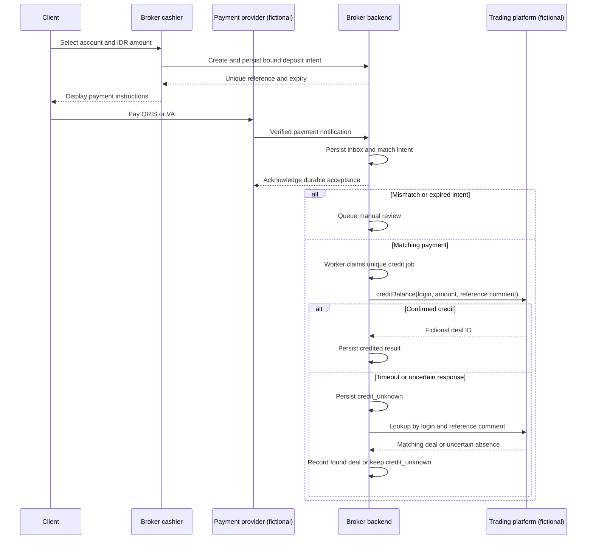

Illustrative only - not the PAYJN API specification; use your approved integration documentation

Credit MT4/MT5 trading accounts exactly once from Indonesian QRIS and virtual account deposits: map each deposit to a client and trading account, prevent double credits, and send mismatches to review.

# Illustrative MT4/MT5 deposit matching

Educational examples published by PAYJN, accompanying the article linked below.
Every field name, status, header, endpoint, signature rule and provider identifier
in this repository is fictional. No real credentials, network requests, merchant
records or bank partnership information are included.

## Problem background

Money arriving is only one part of a deposit. Duplicate notifications can credit
twice, a changing cashier session can select the wrong trading account, and a
missing webhook can leave a payment uncredited. Bind the verified broker client,
trading login, expected amount and expiry before displaying payment instructions.
Use that stored binding rather than the client's current session when crediting.

This example uses per-deposit references for dynamic QRIS or one-time VAs.
Fixed VAs need permanent account bindings and an explicit open-amount policy.
One reference represents one payment intent here; real provider transaction IDs
also need a uniqueness constraint so one payment cannot fund multiple intents.



The diagram shows production persistence boundaries. This repository supplies
only in-memory matching/worker logic and a fake adapter in tests; it does not
implement an HTTP handler, database, queue, scheduler or real authentication.

## How to run

Requires Node.js 18+; no third-party dependencies and no installation step.
Run commands from this directory.

```sh
node --test
```

Tests inject a fake trading platform, including concurrent duplicate notifications
and a timeout after the platform has accepted a balance operation.

```js
import { createDepositIntent } from './src/deposit-intent.js';
import { DemoCreditor } from './src/credit.js';

const intent = createDepositIntent({ clientId: 'demo-client', login: 'demo-login',
  amountMinor: 150000, now: 1000, expiresAt: 2000 });
const worker = new DemoCreditor({ tradingPlatform: {
  creditBalance: async (login, amount, comment) => ({ id: 'demo-deal' }),
  findCredit: async (login, comment) => null,
} });
worker.addIntent(intent);
await worker.credit({ verified: true, status: 'demo_settled',
  reference: intent.reference, currency: 'IDR', amountMinor: 150000, paidAt: 1500 });
```

`verified: true` is a fictional test boundary, not authentication. Real handlers
must authenticate exact notification bytes under approved documentation, persist
acceptance, acknowledge promptly and enqueue credit work separately. Only the
fictional `demo_settled` notification status is accepted. Other statuses and
malformed amounts throw without crediting.

Amounts are positive safe integers in a fictional minor-unit convention of one
unit per IDR. Timestamps are integer Unix milliseconds; payment at or after
expiry requires review. This adapter assumes an IDR trading account and passes
IDR units unchanged. For another account currency, implement approved conversion,
rounding and account checks, and durably record the original IDR amount, rate and
credited amount. Verify client ownership of the trading login before creation.

## Modules

| File | Purpose |
| --- | --- |
| `src/deposit-intent.js` | Creates an immutable client/account/IDR/amount/expiry binding with a unique fictional reference. |
| `src/review.js` | Determines unknown reference, amount, currency, payer-name, expiry and status review reasons. |
| `src/credit.js` | Reserves one job per reference before awaiting the injected adapter; tracks uncertain credits and recovers by lookup. |
| `test/deposit.test.js` | Fake adapter tests for binding, review, concurrency, conflicting references and timeout recovery. |

## Decision table

| Situation | Decision |
| --- | --- |
| Verified settled payment matches an awaiting intent | Call `creditBalance(login, amount, comment)` once using the bound login. |
| Identical concurrent or later reference | Share the existing job/result; never call credit again. |
| Same reference with changed payment details | `needs_review`: `reference_conflict`; preserve the existing job. |
| Unknown reference | `needs_review`: `unknown_reference`. |
| Underpayment or overpayment | `needs_review`: `amount_mismatch`. |
| Currency mismatch | `needs_review`: `currency_mismatch`. |
| Payer name differs from stored verified client name, when both are provided | `needs_review`: `payer_name_mismatch`. |
| Payment at or after intent expiry | `needs_review`: `paid_after_expiry`. |
| Intent is not awaiting payment | `needs_review`: `intent_not_awaiting_payment`. |
| Credit call throws, times out or returns no valid deal ID | `credit_unknown`: `lookup_required`; no automatic retry. |
| Lookup finds the same login, amount and reference comment | Mark credited using the existing deal ID. |
| Lookup is absent, fails or returns mismatching details | Remain `credit_unknown`; no credit submission. |

Name comparison trims outer whitespace and ignores case only. It is a conservative
review signal, not identity verification. Missing names do not prove ownership;
apply the broker's verified-client and third-party-payment policy before credit.

### Trading platform adapter and timeout recovery

The injected `tradingPlatform.creditBalance(login, amount, comment)` and
`findCredit(login, comment)` interfaces are fictional. The comment is
`DEMO-DEP:<reference>`. Successful credit returns `{ id }`; lookup returns
`{ id, login, amountMinor, comment }` or null. The adapter must enforce a bounded
deadline and report a timeout by rejecting its promise. All errors are treated
as uncertain because acceptance may have occurred before the response was lost.

Call `worker.recover(reference)` to look up an uncertain operation. A matching
deal records success without another balance call. Ordinary absence is not proof
that the original operation cannot still complete. This demo provides no retry
operation: even after an absent lookup, keep the deposit for reconciliation.
Never attach a generic retry policy to a balance operation. Recovery lookups may
be repeated safely. Real MT5 Manager API usage must follow MetaQuotes' licensed
documentation, including permitted access, amount representation and deal lookup
semantics. This code does not implement that API.

### Persistence and reconciliation

**The Maps are volatile and safe only within one process lifetime.** A restart
loses idempotency state. In production, persist intent bindings before displaying
instructions and use a durable inbox and worker. Enforce unique provider payment
references, deposit credits and platform deal IDs, with database transactions and
exclusive worker claims. Retain review and uncertain-operation records durably.

Persist the reference comment and credit claim before the external call. After a
crash between platform acceptance and local commit, query the platform by the
persisted login and comment before considering another action. A database
transaction alone cannot make an external platform call atomic. Adapter lookup
and reconciliation guarantees must be validated for the real platform.

Reconcile recent provider payments through the same matching path to recover
missing notifications. Investigate locally stuck credits and unknown references;
compare daily settlement reports with deposits, credits, fees and returned funds.
Do not use screenshots or browser redirects as payment evidence. Human review
resolution, FX conversion, refunds and withdrawals are outside this example.

## Compliance note

For brokers serving Indonesian clients: since 10 January 2025, forex derivatives
supervision moved from Bappebti to Bank Indonesia. PAYJN reviews each broker
individually. Technical deposit matching does not replace licensing, client
verification or merchant onboarding requirements.

## Further reading

These links provide context; they do not define this fictional protocol.

- [Indonesia forex broker payments](https://www.payjn.com/markets/indonesia/forex-brokers/)
- [MT4/MT5 deposit account matching](https://www.payjn.com/guides/indonesia-forex-mt4-mt5-deposit-account-matching/)
- [Duplicate payment callbacks](https://www.payjn.com/help/duplicate-payment-callbacks/)
- [Companion article: crediting MT5 accounts exactly once](https://dev.to/jaysononlyone/crediting-mt5-trading-accounts-from-indonesian-qris-and-virtual-account-deposits-exactly-once-4b57)

## License

MIT - copyright PAYJN. See [LICENSE](LICENSE).
